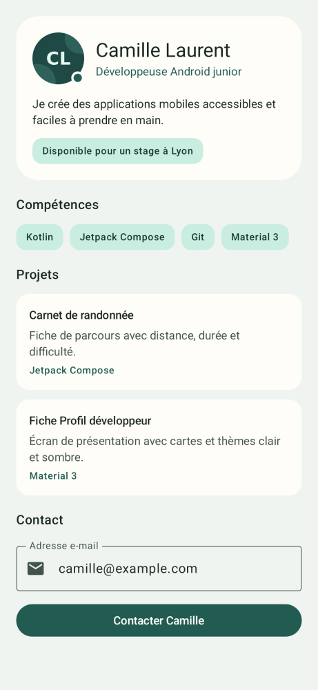
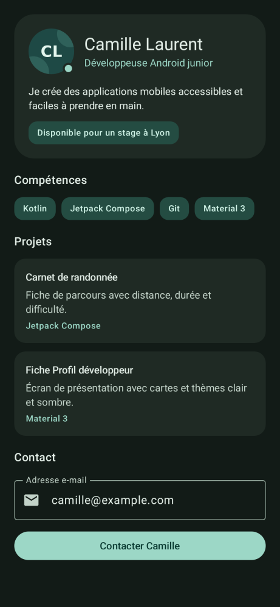

# Profil développeur UI

Application Android en Jetpack Compose qui présente Camille Laurent, une développeuse Android junior fictive. La fiche contient son avatar, sa disponibilité, ses compétences, ses projets et une section de contact. Les données sont définies dans le code Kotlin.

## Composants Compose

- `Text` pour le nom, les titres de section et les descriptions.
- `Image` pour l’avatar local aux initiales de Camille.
- `Card` pour chaque projet. La même fonction `CarteProjet` reçoit les données de chaque carte.
- `OutlinedTextField` en lecture seule pour l’adresse e-mail et `Icon` pour le pictogramme d’enveloppe.
- `Button` pour l’action « Contacter Camille ». Le clic transmet l’événement à un callback prévu pour une future action.
- `Surface` pour le fond arrondi de l’en-tête, le badge de l’avatar et les pastilles.

## Mise en page et listes

`Scaffold` fournit les marges système. Une `Box` centre la fiche et une seconde superpose le badge à l’avatar. Une `Row` place l’avatar à côté du nom et du rôle. Les `Column` empilent le contenu des cartes et du contact. Les `Spacer` séparent les éléments de l’en-tête.

La `LazyColumn` permet de faire défiler l’ensemble de la fiche. Chaque projet est un élément de la liste rendu par `CarteProjet`. Une `LazyRow` permet de faire défiler les compétences horizontalement. Chaque compétence utilise `Pastille`, également utilisée pour la disponibilité.

## Thèmes clair et sombre

Le thème Material 3 suit le réglage système. Les deux palettes utilisent le vert pour le bouton, le rôle et les pastilles. Le thème clair combine un fond pâle avec des cartes ivoire. Le thème sombre combine un fond vert foncé avec des cartes et des textes plus clairs. Les styles de `MaterialTheme.typography` hiérarchisent le nom, les titres et le texte courant. Les formes de `MaterialTheme.shapes` donnent des coins cohérents aux surfaces et aux cartes.

## Notions du chapitre réutilisées

J’ai réutilisé les composants fondamentaux, les layouts, les listes paresseuses et les cartes paramétrées. J’ai également appliqué les couleurs, la typographie et les formes de Material 3 dans les modes clair et sombre. Deux previews présentent le même profil avec les deux thèmes.

## Lancer le projet

Ouvrir ce dossier dans Android Studio avec un JDK 17 ou 21 et le SDK Android 35, puis lancer la configuration `app`. Les deux previews se trouvent dans `MainActivity.kt`, accessibles en mode **Split** ou **Design**.

## Captures des previews

Les deux aperçus ont été rendus avec Paparazzi.

| Thème clair | Thème sombre |
| --- | --- |
|  |  |
